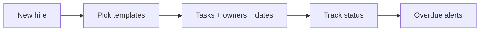

# Employee Onboarding Workflow

> One new-hire record creates every onboarding task with an owner and a deadline, and chases the ones running late.

     

**Sector:** HR & Operations  ·  **Project 19 of 50** in my [AI Automation Projects series](https://github.com/Princewill106/Princewill106)

## The problem

New hires show up to no laptop, no email account and a manager in back-to-back meetings. Onboarding lives in someone's head, so it's different for every hire and something always slips.

## How it works



1. **Trigger** — A new-hire record (name, role, department, start date, remote or onsite) starts the flow.
2. **Templates** — Common tasks plus department and role extras are pulled from `templates.json`.
3. **Schedule** — Each task's due date is computed from its offset (e.g. -5 days for laptop, +30 for the first review), skipping weekends.
4. **Track** — Task status is tracked in `output/onboarding_<name>.csv`; overdue tasks are listed for each owner.
5. **Welcome** — A personalised welcome message with day-one details is drafted for the hire.

## Features

- Role and department task templates
- Business-day due dates relative to start
- Owner-based overdue alerts
- Remote vs onsite variations
- Welcome message

## Quick start

```bash
git clone https://github.com/Princewill106/employee-onboarding-workflow.git
cd employee-onboarding-workflow
python main.py --demo
```

No installs needed: it uses only the Python standard library. The demo runs fully offline using the sample data in this repo.

**Optional: plug in an LLM.** Copy `.env.example` to `.env` and add an Anthropic or OpenAI key. The project will then use the model for the language-heavy steps and fall back to its rule-based logic if a call fails.

Run the tests:

```bash
python -m unittest -v
```

## Sample output

```text
== Ifeanyi Obi | Automation Engineer (Engineering) starts 2026-10-12 ==
  [✔] 2026-09-28  HR         Send offer letter and contract to Ifeanyi Obi
  [✔] 2026-10-05  HR         Collect ID, bank details and NHF/pension forms
  [!] 2026-10-06  IT         Courier laptop and headset
  [!] 2026-10-07  IT         Create email and Slack accounts
  [!] 2026-10-08  Tunde      Prepare 30-60-90 day plan
  [ ] 2026-10-09  IT         Grant GitHub and cloud access
  [ ] 2026-10-12  Tunde      Day one welcome and introductions
  [ ] 2026-10-13  HR         Company policies walkthrough
  [ ] 2026-10-14  Tunde      Pair on first small task
  [ ] 2026-10-15  Tunde      First 1:1 with manager
  [ ] 2026-11-11  Tunde      30-day check-in
  OVERDUE (3): IT: Courier laptop and headset; IT: Create email and Slack accounts; Tunde: Prepare 30-60-90 day plan
  Welcome: Hi Ifeanyi, welcome to the team! On 2026-10-12 join the 9am video call link in your email. Tunde will be your manager.

== Ruth Danjuma | Account Executive (Sales) starts 2026-10-19 ==
  [!] 2026-10-05  HR         Send offer letter and contract to Ruth Danjuma
  [ ] 2026-10-12  HR         Collect ID, bank details and NHF/pension forms
  [ ] 2026-10-14  IT         Create email and Slack accounts
  [ ] 2026-10-15  Kemi       Prepare 30-60-90 day plan
  [ ] 2026-10-16  IT         Create CRM seat
  [ ] 2026-10-16  IT         Set up desk, laptop and access card
  [ ] 2026-10-19  Kemi       Day one welcome and introductions
  [ ] 2026-10-20  HR         Company policies walkthrough
  [ ] 2026-10-22  Kemi       First 1:1 with manager
  [ ] 2026-10-23  Kemi       Shadow three sales calls
  [ ] 2026-11-18  Kemi       30-day check-in
  OVERDUE (1): HR: Send offer letter and contract to Ruth Danjuma
  Welcome: Hi Ruth, welcome to the team! On 2026-10-19 please arrive at 9am at reception. Kemi will be your manager.
```

## Use it in n8n (no code needed)

[`n8n-workflow.json`](n8n-workflow.json) is a ready-to-import n8n version of this project, built for n8n 1.x.

1. In n8n, open **Workflows → Import from File** and choose `n8n-workflow.json`.
2. Click **Test workflow**. It runs the full logic on the sample data built into the *Sample data* node, so you can see the results before connecting anything.
3. Open each output node and connect your accounts: Gmail (OAuth2), Google Sheets (OAuth2). For Google Sheets, pick your spreadsheet and sheet.
4. Adjust the settings at the top of the **Logic** node (thresholds, templates, contacts), then **Activate**.

**Flow:** **Webhook** (`POST /webhook/new-hire`) → **Logic** (Code node) → **Route** (Switch)

**Outputs:**
- Add tasks to onboarding tracker
- Email welcome note

The Logic node is a JavaScript port of the rules in `main.py`, so you can run the project in n8n without Python.

## Use it on your own data

Edit `templates.json` for your company and add hires to `sample_hires.json`. Run `python main.py --today 2026-10-09` daily (cron or n8n) to see overdue tasks.

## Project structure

```text
n8n-workflow.json            Importable n8n workflow
.env.example                 Optional API key settings
.gitignore                   Git ignore rules
LICENSE                      MIT license
README.md                    This file
llm.py                       Optional LLM helper (offline fallback)
main.py                      Entry point and core logic
requirements.txt             Dependencies (stdlib only)
sample_hires.json            Sample input data for the demo
templates.json               Reference / config data
test_main.py                 Unit tests
```

## Who this is for

- HR teams at growing startups
- Schools onboarding new teachers
- Operations managers in multi-branch businesses

## Ideas to extend it

- [ ] Create tasks in Trello/Asana/ClickUp via API
- [ ] Slack or WhatsApp nudges to owners
- [ ] Collect documents via a form
- [ ] 30/60/90-day check-in surveys

## About

Built by **Ogbu Ugochukwu Princewill**, AI Automation Lead and robotics engineer. I teach people and businesses to build with AI, not just talk about it. [LinkedIn](https://www.linkedin.com/in/ugochukwu-ogbu-653a0816a)

If this helped you, give it a ⭐ and share what you built with it.

## License

MIT — see [LICENSE](LICENSE).
